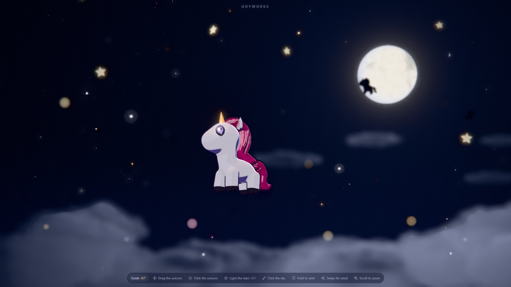
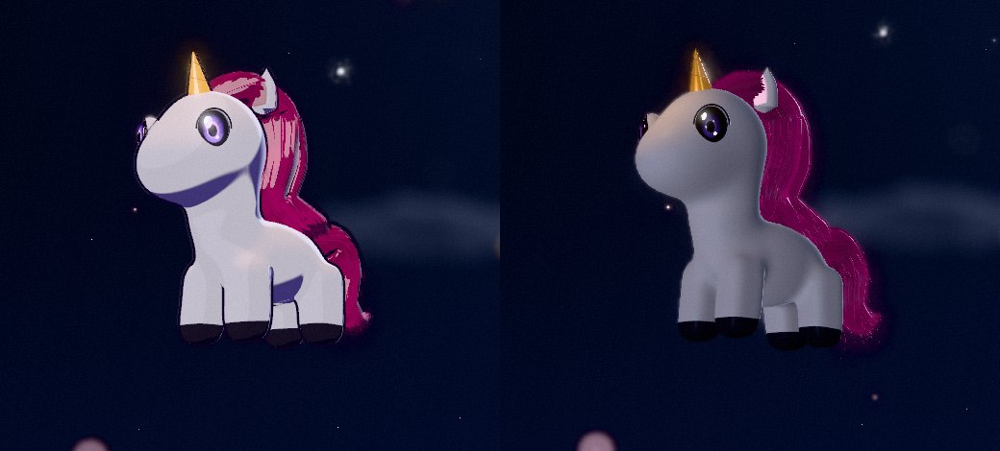
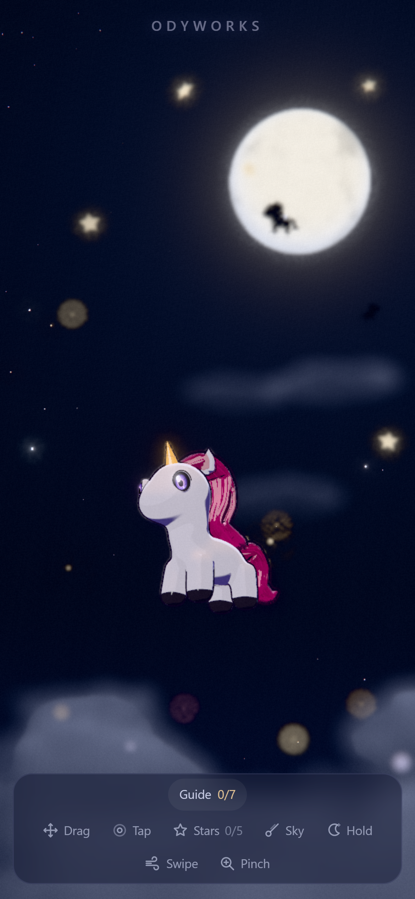
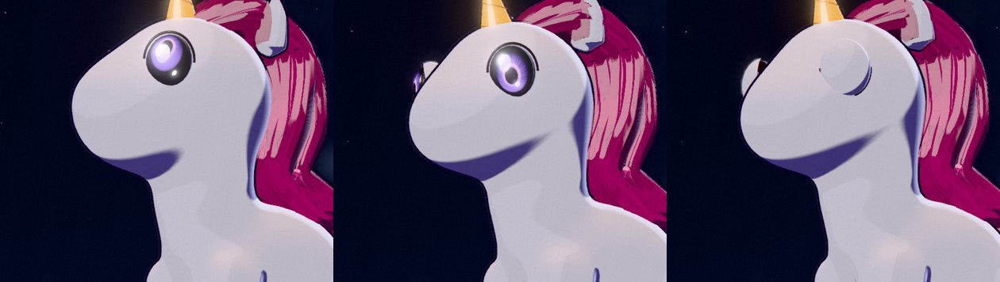

<div align="center">


# Moonlit Unicorn

**A small, living toon unicorn floats through volumetric clouds under a huge moon: a cinematic, interactive WebGL scene.**

[English](README.md) · [Bahasa Indonesia](README.id.md)

<sub>Made by <b>Odyworks</b> · Three.js · TypeScript · Vite</sub>



</div>

---

## About

Moonlit Unicorn is an interactive art piece rather than a landing page: one hero character, a lot of darkness, and a world with real depth. The camera behaves like a slow cinematic observer, depth of field blurs the foreground clouds and turns distant stars into bokeh, and everything reacts softly to the pointer.

The unicorn is **alive**: it blinks, looks at your cursor, twitches its ears, swishes its tail, breathes, and gets sleepy if you leave it alone.

## Features

- **Cinematic look:** real depth-aware bokeh depth of field, restrained bloom, vignette, film grain, near-invisible chromatic aberration.
- **Volumetric clouds:** raymarched per cloud (Beer-Lambert light transport, silver lining toward the moon), rendered at half resolution and composited into the depth of field.
- **Moonlit world:** a distant 3D moon with surface detail, clustered stars at several depths, drifting dust, far-away unicorn silhouettes.
- **Toon unicorn:** hand-written cel shading, ink outlines, strand-based hair with flyaways, and expressive eyes with drawn sparkles. A realistic style is one config switch away.
- **Alive:** gaze with eye contact and saccades, blinks, moods (happy, surprised, sleepy), ear twitches, breathing, tail swishes, mane that follows the wind.
- **Soft physics:** drag the unicorn and it springs back; wind gusts push mane, tail, dust and clouds.
- **Polished details:** animated preloader, bottom guide bar, reduced-motion support, responsive layouts for desktop and phones, adaptive quality.

<div align="center">

<br /><sub>Toon (default) vs realistic, switchable live.</sub>
</div>

<div align="center">
&nbsp;&nbsp;
<br /><sub>Mobile layout · Expressive toon eyes</sub>
</div>

## Interactions

| Action | Mouse / keyboard | Touch |
| --- | --- | --- |
| Look around (parallax) | Move the pointer | Drag on the sky |
| Drag the unicorn | Press and drag it | Press and drag it |
| Poke the unicorn | Click it · `Enter` / `Space` | Tap it |
| Light the stars | Click the 5 glowing stars (they link into a constellation) | Tap them |
| Shooting star | Click empty sky | Tap the sky |
| Make a wish | Press and hold on the sky | Press and hold |
| Wind gust | Swipe fast | Swipe fast |
| Zoom | Scroll | Pinch |
| Nudge the unicorn | Arrow keys | n/a |

Light all five stars for a meteor shower and a twirl. The guide bar at the bottom tracks which interactions you have discovered, and each chip is a button that performs it.

## Getting started

Requires **Node.js 20.19+ or 22+**.

```bash
npm install
npm run dev        # http://localhost:5173 (or the port Vite prints)
```

```bash
npm run build      # type-check + production build into dist/
npm run preview    # serve the production build locally
```

Open a built `dist/` through a web server (not by double-clicking `index.html`): browsers block module scripts on `file://`.

### Useful URL options

| URL | Effect |
| --- | --- |
| `/?quality=low` | Force the lighter quality tier (what phones get) |
| `/?debug` | Live tweaking panel (**development builds only**) |

## Customising the look

Every artistic value lives in **[`src/config/sceneConfig.ts`](src/config/sceneConfig.ts)**: camera and composition, moon, sky colours, lighting, clouds, stars, depth of field, bloom, toon palette and outline width, interaction strength, quality. The `?debug` panel edits the same object live.

```ts
hero: { style: 'toon', /* or 'realistic' */ yaw: 0.88, floatAmplitude: 0.2 },
dof:  { focusRange: 1.15, nearBlur: 0.034, farBlur: 0.02 },
```

## Project structure

```
src/
  config/sceneConfig.ts     all art values
  scene/
    World.ts                orchestrator: loop, interactions, quality
    CameraRig.ts            damped cinematic camera, pointer parallax, zoom
    Moon.ts                 sky dome, moon, moonlit haze, environment map
    Clouds.ts               volumetric raymarched clouds
    Stars.ts  Particles.ts  Beams.ts   stars, bokeh lights, dust, meteors, constellation
    UnicornController.ts    the hero: bones, motion, moods, styles, outlines
    HeroEyes.ts  HeroHair.ts  HeroShading.ts   eyes, strand hair, toon + NaN-safe shaders
    Interaction.ts          pointer, touch, wheel, keyboard
    PostProcessing.ts       bokeh DOF, bloom, grade
    Debug.ts                dev-only tweak panel
  ui/GuideBar.ts            bottom guide bar
public/models/unicorn.glb   the character
```

## Performance

Desktop targets 60+ fps on a mid-range GPU; resolution is capped (DPR 1.75 desktop, 1.5 mobile) and drops automatically if frames get slow. Phones get fewer particles, fewer hair layers, cheaper clouds and no shadows.

## Notes

- The character comes from a separate model project and is exported to `public/models/unicorn.glb`. Its mane and tail bones are siblings of the body pivot, so whole-body motion is applied on parent groups.
- Hair and tangent-space shaders are patched to be **NaN-safe**: a few inner mane faces have degenerate tangents, and a single NaN pixel would otherwise black out the whole frame through the bloom.

## Credits

Created by **Odyworks**. Built with [Three.js](https://threejs.org/), [Vite](https://vite.dev/) and TypeScript.
